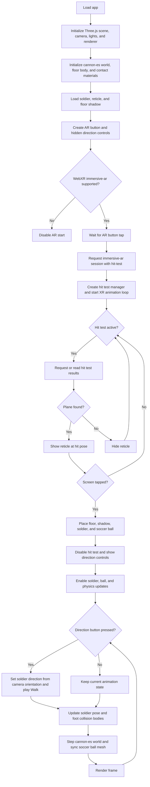

# ar-kick-ball
AR Kick Ball - WebXR ARCore-enabled game for mobile browser.

## Status Update:
Physics (courtesy of [cannon-es](https://www.npmjs.com/package/cannon-es)) added to soccer ball, solider, and floor.


https://github.com/patrick-s-young/ar-kick-ball/assets/42591798/637e16c9-405d-4b3e-814f-096daffa86f7


## Logic Flowchart




Project created with [webxr-arcore-boilerplate](https://github.com/patrick-s-young/webxr-arcore-boilerplate)
## Running Locally

Make sure you have [Node.js](http://nodejs.org/) installed.

```sh
git clone https://github.com/patrick-s-young/ar-kick-ball.git # or clone your own fork
cd ar-kick-ball
yarn
yarn start
```
## Debug Mode

Debug mode allows for faster experimentation/iteration in the browser. Code can then be propagated from DebugApp.js to App.js.

```sh
yarn debug
```


https://github.com/patrick-s-young/ar-kick-ball/assets/42591798/8938c3ea-ab77-473f-9a78-f08fca8b9642


## Device Requirements
See Google's [ARCore supported devices](https://developers.google.com/ar/devices).

- Set your ARCore-supported Android device to developer mode.
- Plug your device into your workstation via USB
- On your workstation, open a Chrome browser and set the location to: `chrome://inspect/#devices`
- Find your device and click the link to launch the dev console
  
## Built With

* [Three.js](https://www.npmjs.com/package/three) - An easy to use, lightweight, cross-browser, general purpose 3D library.
* [cannon-es](https://www.npmjs.com/package/cannon-es) - Lightweight 3D physics engine.
* [webpack](https://webpack.js.org/) - static module builder.
* [maximo](https://www.mixamo.com/) - 3D characters, skeletal rigs, and animations.
* [turbosquid](https://www.turbosquid.com/) - soccer ball.

## Authors

* **Patrick Young** - [Patrick Young](https://github.com/patrick-s-young)

## License

This project is licensed under the MIT License - see the [LICENSE](LICENSE) file for details.

